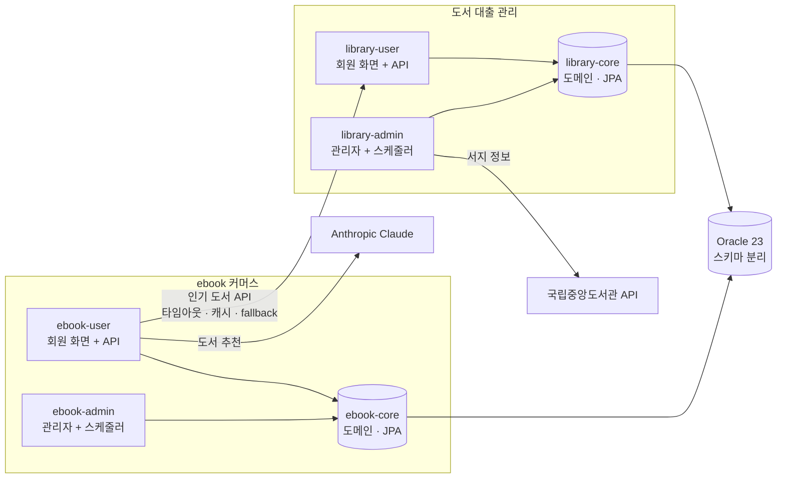

# book-platform

도서를 주제로 한 **Spring Boot 백엔드 개인 프로젝트**입니다.
도서관 대출 시스템과 전자책 쇼핑몰, 두 서비스를 설계부터 테스트·배포 구성까지 혼자 만들었습니다.

기능 수를 늘리기보다 **실무에서 사고가 나는 지점**(동시 요청, 결제와 외부 호출의 트랜잭션 경계, 인증 토큰 탈취, 유료 API 비용)을 정확히 다루는 데 집중했습니다.

| | |
|---|---|
| 구성 | 독립 서비스 2개 · 실행 앱 4개(회원/관리자) · Gradle 멀티모듈 모노레포 |
| 규모 | 테이블 28개 · 자바 클래스 300여 개 · 화면 47개 · REST API(Swagger 문서화) |
| 테스트 | 324개 (단위 + Testcontainers Oracle 통합), GitHub Actions에서 PR마다 실행 |
| 진행 방식 | 기능 단위 브랜치 → PR 29건, 커밋 본문에 "왜 이렇게 했는지" 기록 |

## 서비스

| 서비스 | 내용 | 회원 / 관리자 |
|---|---|---|
| [도서 대출 관리](library-loan-service) | 종이책 검색, 대출·반납·연장, 예약 대기열, 연체 정지. 관리자는 국립중앙도서관 API로 서지 정보를 불러와 도서 등록 | 8081 / 9081 |
| [ebook 커머스](ebook-commerce-service) | 전자책 검색, 장바구니, 주문·결제·부분 환불, 내 서재·뷰어, 리뷰, **AI 도서 추천 챗봇**. 관리자는 상품·주문·매출·챗봇 운영 | 8082 / 9082 |



서비스마다 `core`(도메인) · `user`(회원 앱) · `admin`(관리자 앱) 모듈로 나누고, 의존은 `user → core`, `admin → core` 한 방향만 허용했습니다.

## 핵심 구현

### 1. 동시 요청에서도 깨지지 않는 대출과 결제

| 상황 | 해결 | 검증 |
|---|---|---|
| 남은 한 권을 여러 명이 동시에 대출 | 낙관적 락(`@Version`). 충돌한 요청은 "이미 대출된 자료"로 안내 | [`LoanConcurrencyTest`](library-loan-service/library-core/src/test/java/com/ryu/library/loan/service/LoanConcurrencyTest.java) — 스레드 동시 실행으로 1건만 성공 확인 |
| 같은 주문에 결제 요청이 두 번 | 주문 행을 비관적 락으로 잠근 뒤 상태 확인 | [`OrderPaymentScenarioTest`](ebook-commerce-service/ebook-core/src/test/java/com/ryu/ebook/order/service/OrderPaymentScenarioTest.java) |
| 같은 책 중복 구매·중복 리뷰 | UNIQUE 제약을 최후 방어선으로 두고 비즈니스 예외로 변환 | Repository 테스트 |

충돌 빈도에 따라 락 방식을 다르게 골랐습니다. 대출은 충돌이 드물어 낙관적 락, 결제는 반드시 막아야 해서 비관적 락입니다.

### 2. 결제·환불: 외부 호출은 트랜잭션 밖에서

PG 호출을 트랜잭션 안에서 하면 응답을 기다리는 동안 DB 커넥션과 락을 붙잡습니다.
그래서 **PG 승인 → (트랜잭션) 주문 잠금·결제 반영·서재 지급** 순서로 나누고, DB 반영이 실패하면 PG 승인을 취소하는 보상 처리를 넣었습니다.
환불은 결제 후 7일 이내·미열람 항목만 허용하는 부분 환불(주문 항목 단위)입니다.

[`PaymentService`](ebook-commerce-service/ebook-core/src/main/java/com/ryu/ebook/payment/service/PaymentService.java) · [`RefundService`](ebook-commerce-service/ebook-core/src/main/java/com/ryu/ebook/order/service/RefundService.java) · [`RefundScenarioTest`](ebook-commerce-service/ebook-core/src/test/java/com/ryu/ebook/order/service/RefundScenarioTest.java)

### 3. 인증: 화면은 세션, API는 JWT

- `SecurityFilterChain`을 둘로 나눠 화면은 세션 + CSRF, API는 무상태 JWT로 처리
- Access 30분 + Refresh 7일. Refresh Token은 **쓸 때마다 교체**하고, 이미 쓴 토큰이 다시 오면 탈취로 보고 그 회원의 토큰을 전부 무효화
- 토큰 원문은 저장하지 않고 SHA-256 해시만 저장

[`AuthService`](ebook-commerce-service/ebook-user/src/main/java/com/ryu/ebook/user/auth/service/AuthService.java)

### 4. AI 도서 추천 챗봇 (Spring AI + Claude)

| 문제 | 해결 |
|---|---|
| LLM이 없는 책을 지어냄 | 도구 호출(`@Tool`)로 DB 검색을 열어 주고, 검색 결과에 있는 판매 중인 책만 추천하게 제한 |
| 모델이 남의 정보를 조회할 수 있음 | 회원 번호를 도구 인자로 받지 않고 서버가 `ToolContext`로 주입 |
| 유료 API 비용 통제 | 계정별 일일 토큰 한도 · 서비스 전체 한도 · 관리자 화면의 즉시 중단 스위치 · 질문 길이/연타/검색 횟수 상한 |
| 동시 요청에서 사용량 누락 | Oracle `MERGE` 한 문장으로 생성과 누적을 원자적으로 처리. 날짜별 행이라 초기화 배치 불필요 |
| 프롬프트 수정마다 재배포 | 시스템 프롬프트를 DB에 두고 관리자 화면에서 수정, 변경 이력 보관 |
| 응답 대기 시간 | SSE 스트리밍(가상 스레드). 스크립트가 없어도 폼 전송으로 동작 |
| 테스트가 실제 API에 의존 | 모델 호출을 포트 인터페이스 하나로 감싸 테스트에서는 대역으로 교체 |

[`ChatService`](ebook-commerce-service/ebook-user/src/main/java/com/ryu/ebook/user/chat/service/ChatService.java) · [`EbookSearchTools`](ebook-commerce-service/ebook-user/src/main/java/com/ryu/ebook/user/chat/client/EbookSearchTools.java) · [`AnthropicChatCompletionPort`](ebook-commerce-service/ebook-user/src/main/java/com/ryu/ebook/user/chat/client/AnthropicChatCompletionPort.java) · [설계 설명](ebook-commerce-service/README.md#ai-도서-추천-챗봇)

### 5. 외부 API와 서비스 간 통신

- **국립중앙도서관 API**: 연결·응답 타임아웃, HTTP 200이어도 본문의 오류 코드 확인, 인증키가 든 URL을 로그에 남기지 않음 — [`NationalLibraryClient`](library-loan-service/library-admin/src/main/java/com/ryu/library/admin/book/client/NationalLibraryClient.java)
- **ebook → 도서관**: HTTP Interface로 인기 도서를 조회해 같은 ISBN의 전자책을 추천. 도서관 서비스가 죽어도 메인 화면이 뜨도록 짧은 타임아웃 + 캐시 + fallback — [`LibraryRecommendationService`](ebook-commerce-service/ebook-user/src/main/java/com/ryu/ebook/user/library/service/LibraryRecommendationService.java)
- 두 경우 모두 WireMock으로 정상·오류·지연을 재현해 테스트

### 6. DB 설계와 조회 성능

- **FK 제약 없는 설계**: 참조 무결성은 서비스에서 검증하고 참조 컬럼마다 인덱스를 둠. 삭제는 상태 변경(소프트 삭제)
- **Flyway**로 스키마 관리, Hibernate는 `validate`만. 테스트도 같은 마이그레이션으로 스키마 생성
- **N+1 제거**: 목록은 JPQL 조인 + DTO Projection, 컬렉션 페이징은 `default_batch_fetch_size`
- `open-in-view: false`로 지연 로딩을 서비스 계층 안에서 끝내고, 엔티티를 컨트롤러 밖으로 내보내지 않음

설계 규칙 전체는 [`docs/01-rules.md`](docs/01-rules.md), 테이블 설계는 서비스별 ERD([도서관](library-loan-service/docs/01-erd.md) · [ebook](ebook-commerce-service/docs/01-erd.md))에 있습니다.

## 기술 스택

| 구분 | 사용 기술 |
|---|---|
| Language / Framework | Java 21, Spring Boot 4.1 (MVC), Spring Security, Spring Data JPA |
| DB | Oracle 23 Free, Flyway |
| AI | Spring AI 2.0, Anthropic Claude |
| View / 문서 | Thymeleaf, springdoc-openapi (Swagger UI) |
| Test | JUnit 5, Mockito, Testcontainers(Oracle), WireMock |
| Infra | Docker Compose, GitHub Actions, Gradle 9 멀티모듈 |

## 테스트

| 대상 | 방식 |
|---|---|
| 도메인 규칙 | 순수 JUnit (스프링 없이) |
| 서비스 | Mockito 단위 테스트 |
| Repository · 마이그레이션 | Testcontainers로 실제 Oracle에서 실행 |
| 컨트롤러 | `@WebMvcTest` + 실제 보안 설정 (인증, CSRF, 검증) |
| 핵심 시나리오 | 대출-반납, 주문-결제-환불 통합 테스트 + 동시 요청 테스트 |

대출 한도, 연체 정지, 중복 결제, 환불 조건 같은 핵심 규칙은 실패 케이스를 반드시 포함했습니다.

## 실행

JDK 21과 Docker가 필요합니다.

```bash
cp .env.example .env                         # 비밀번호와 키를 직접 채웁니다
docker compose --profile app up -d --build   # Oracle + 앱 4개
```

| 앱 | 주소 |
|---|---|
| 도서 대출 회원 / 관리자 | http://localhost:8081 / http://localhost:9081 |
| ebook 회원 / 관리자 | http://localhost:8082 / http://localhost:9082 |
| API 문서 | http://localhost:8081/swagger-ui.html · http://localhost:8082/swagger-ui.html |

테스트는 서비스 폴더에서 `./gradlew test` (Docker만 켜져 있으면 Testcontainers가 Oracle을 띄웁니다).
IDE 실행 방법과 기능 목록은 각 서비스 README에 있습니다.

## 문서

| 문서 | 내용 |
|---|---|
| [`docs/00-architecture.md`](docs/00-architecture.md) | 컨테이너 구성, 기술 선택 이유, 패키지 구조, 인증 흐름, 서비스 간 통신 |
| [`docs/01-rules.md`](docs/01-rules.md) | 개발 규칙 (DB 설계, 계층, 예외, 트랜잭션, 테스트, Git) |
| 서비스별 `docs/` | ERD와 비즈니스 규칙, 화면 흐름과 API 목록 ([도서관](library-loan-service/docs) · [ebook](ebook-commerce-service/docs)) |
