# ebook 커머스 서비스 - 테이블 설계

## 1. 도메인 요약

| 용어 | 설명 |
|---|---|
| 회원 (MEMBER) | 구매자. 관리자는 상품(전자책) 등록과 주문 관리 |
| 전자책 (EBOOK) | 판매 상품. 재고 개념이 없고 파일 1개가 무한히 팔린다 |
| 장바구니 (CART, CART_ITEM) | 회원당 1개. 같은 전자책은 1개만 담긴다 (수량 없음) |
| 주문 (ORDERS, ORDER_ITEM) | 결제 시점의 가격을 스냅샷으로 보관 |
| 결제 (PAYMENT) | 주문 1건당 결제 1건. 외부 PG 대신 Mock PG로 승인/취소 흐름만 구현 |
| 내 서재 (BOOKSHELF) | 결제 완료로 얻은 소유권. 회원당 전자책 1개 |
| 리뷰 (REVIEW) | 구매한 회원만 작성, 전자책당 1개 |
| 쿠폰 (COUPON, MEMBER_COUPON) | v2. 처음엔 테이블만 만들고 로직은 나중에 |
| AI 추천 대화 (CHAT_SESSION, CHAT_MESSAGE) | 회원당 진행 중 대화 1개. 메시지는 다음 요청에 다시 실어 보낼 기억이면서 화면 이력 |
| 추천 도서 (CHAT_MESSAGE_EBOOK) | 답변에 제목이 나온 전자책. 화면과 API가 같은 추천 결과를 보여 주도록 메시지에 묶는다 |
| 챗봇 프롬프트 (CHAT_PROMPT, CHAT_PROMPT_HISTORY) | 관리자가 고치는 시스템 프롬프트와 바뀌기 전 본문 |
| 챗봇 설정 (CHAT_SETTING, MEMBER_CHAT_SETTING) | 전체 중단 스위치·기본 한도와 계정별 사용 여부·일일 한도 |
| 토큰 사용량 (CHAT_TOKEN_USAGE_DAILY) | 회원·날짜별 토큰 누적. 날짜마다 행이 생기므로 자정 초기화 배치가 없다 |

종이책 커머스와 다른 점: 재고와 배송이 없습니다. 대신 "소유권"과 "다운로드/열람"이 핵심이고,
같은 책을 두 번 사지 못하게 막는 것, 환불 시 서재에서 회수하는 것이 비즈니스 규칙의 중심입니다.

## 2. ERD

모든 관계선은 **FK 제약이 없는 논리 참조**입니다. 참조 무결성은 애플리케이션에서 검증합니다(`docs/01-rules.md` 1-2절).
컬럼 설명의 "→ 테이블"은 그 컬럼이 가리키는 대상입니다. 모든 테이블에 CREATED_AT, UPDATED_AT이 있지만 그림에서는 일부 생략했습니다.

```mermaid
erDiagram
    MEMBER ||--|| CART : "보유"
    CART ||--o{ CART_ITEM : "담김"
    EBOOK ||--o{ CART_ITEM : ""
    CATEGORY ||--o{ EBOOK : "분류"
    CATEGORY ||--o{ CATEGORY : "상위"
    MEMBER ||--o{ ORDERS : "주문"
    ORDERS ||--|{ ORDER_ITEM : "구성"
    EBOOK ||--o{ ORDER_ITEM : ""
    ORDERS ||--o| PAYMENT : "결제"
    MEMBER ||--o{ BOOKSHELF : "소유"
    EBOOK ||--o{ BOOKSHELF : ""
    ORDER_ITEM ||--o| BOOKSHELF : "구매 근거"
    MEMBER ||--o{ REVIEW : "작성"
    EBOOK ||--o{ REVIEW : "대상"
    COUPON ||--o{ MEMBER_COUPON : "발급"
    MEMBER ||--o{ MEMBER_COUPON : "보유"
    MEMBER_COUPON |o--o| ORDERS : "사용"
    MEMBER ||--o{ CHAT_SESSION : "대화"
    CHAT_SESSION ||--o{ CHAT_MESSAGE : "구성"
    MEMBER ||--o| MEMBER_CHAT_SETTING : "챗봇 설정"
    MEMBER ||--o{ CHAT_TOKEN_USAGE_DAILY : "사용량"
    CHAT_PROMPT ||--o{ CHAT_PROMPT_HISTORY : "변경 이력"
    CHAT_MESSAGE ||--o{ CHAT_MESSAGE_EBOOK : "추천 도서"
    EBOOK ||--o{ CHAT_MESSAGE_EBOOK : ""

    MEMBER {
        NUMBER MEMBER_ID PK
        VARCHAR2 LOGIN_ID UK
        VARCHAR2 PASSWORD
        VARCHAR2 NAME
        VARCHAR2 EMAIL UK
        VARCHAR2 ROLE "USER, ADMIN"
        VARCHAR2 STATUS "ACTIVE, WITHDRAWN"
        TIMESTAMP CREATED_AT
        TIMESTAMP UPDATED_AT
    }
    CATEGORY {
        NUMBER CATEGORY_ID PK
        NUMBER PARENT_ID "→ CATEGORY, NULL이면 최상위"
        VARCHAR2 NAME
        NUMBER SORT_ORDER
    }
    EBOOK {
        NUMBER EBOOK_ID PK
        NUMBER CATEGORY_ID "→ CATEGORY"
        VARCHAR2 ISBN UK
        VARCHAR2 TITLE
        VARCHAR2 AUTHOR
        VARCHAR2 PUBLISHER
        VARCHAR2 DESCRIPTION
        VARCHAR2 COVER_IMAGE_URL
        NUMBER PRICE "정가"
        NUMBER SALE_PRICE "판매가"
        VARCHAR2 FILE_KEY "파일 저장 키"
        NUMBER FILE_SIZE
        NUMBER PAGE_COUNT
        VARCHAR2 STATUS "ON_SALE, STOP_SALE, HIDDEN"
        DATE PUBLISHED_DATE
        NUMBER SALES_COUNT "판매 수 (비정규화)"
        TIMESTAMP CREATED_AT
        TIMESTAMP UPDATED_AT
    }
    CART {
        NUMBER CART_ID PK
        NUMBER MEMBER_ID UK "→ MEMBER"
        TIMESTAMP CREATED_AT
        TIMESTAMP UPDATED_AT
    }
    CART_ITEM {
        NUMBER CART_ITEM_ID PK
        NUMBER CART_ID "→ CART"
        NUMBER EBOOK_ID "→ EBOOK"
        TIMESTAMP CREATED_AT
        TIMESTAMP UPDATED_AT
    }
    ORDERS {
        NUMBER ORDER_ID PK
        VARCHAR2 ORDER_NO UK "20261104-000001"
        NUMBER MEMBER_ID "→ MEMBER"
        NUMBER MEMBER_COUPON_ID "→ MEMBER_COUPON, NULL 가능"
        VARCHAR2 STATUS "PENDING, PAID, CANCELED, REFUNDED"
        NUMBER TOTAL_AMOUNT "상품 합계"
        NUMBER DISCOUNT_AMOUNT
        NUMBER PAID_AMOUNT "실결제"
        TIMESTAMP ORDERED_AT
        TIMESTAMP PAID_AT
        TIMESTAMP CANCELED_AT
        TIMESTAMP CREATED_AT
        TIMESTAMP UPDATED_AT
    }
    ORDER_ITEM {
        NUMBER ORDER_ITEM_ID PK
        NUMBER ORDER_ID "→ ORDERS"
        NUMBER EBOOK_ID "→ EBOOK"
        VARCHAR2 TITLE_SNAPSHOT
        NUMBER PRICE_SNAPSHOT "주문 당시 판매가"
        VARCHAR2 STATUS "ORDERED, REFUNDED"
    }
    PAYMENT {
        NUMBER PAYMENT_ID PK
        NUMBER ORDER_ID UK "→ ORDERS"
        VARCHAR2 METHOD "CARD, KAKAOPAY, POINT, MOCK"
        NUMBER AMOUNT
        VARCHAR2 STATUS "READY, APPROVED, FAILED, CANCELED"
        VARCHAR2 PG_TID "PG 거래번호"
        VARCHAR2 FAIL_REASON
        TIMESTAMP APPROVED_AT
        TIMESTAMP CANCELED_AT
        TIMESTAMP CREATED_AT
        TIMESTAMP UPDATED_AT
    }
    BOOKSHELF {
        NUMBER BOOKSHELF_ID PK
        NUMBER MEMBER_ID "→ MEMBER"
        NUMBER EBOOK_ID "→ EBOOK"
        NUMBER ORDER_ITEM_ID "→ ORDER_ITEM"
        TIMESTAMP ACQUIRED_AT
        NUMBER LAST_READ_PAGE
        TIMESTAMP LAST_READ_AT
        NUMBER IS_ACTIVE "환불 시 0"
    }
    REVIEW {
        NUMBER REVIEW_ID PK
        NUMBER EBOOK_ID "→ EBOOK"
        NUMBER MEMBER_ID "→ MEMBER"
        NUMBER RATING "1~5"
        VARCHAR2 CONTENT
        TIMESTAMP CREATED_AT
        TIMESTAMP UPDATED_AT
    }
    COUPON {
        NUMBER COUPON_ID PK
        VARCHAR2 NAME
        VARCHAR2 DISCOUNT_TYPE "FIXED, RATE"
        NUMBER DISCOUNT_VALUE
        NUMBER MIN_ORDER_AMOUNT
        NUMBER MAX_DISCOUNT_AMOUNT
        TIMESTAMP VALID_FROM
        TIMESTAMP VALID_TO
    }
    MEMBER_COUPON {
        NUMBER MEMBER_COUPON_ID PK
        NUMBER COUPON_ID "→ COUPON"
        NUMBER MEMBER_ID "→ MEMBER"
        VARCHAR2 STATUS "AVAILABLE, USED, EXPIRED"
        TIMESTAMP USED_AT
    }
    CHAT_PROMPT {
        NUMBER CHAT_PROMPT_ID PK
        VARCHAR2 PROMPT_KEY UK "용도 구분, 예 BOOK_RECOMMEND"
        VARCHAR2 NAME
        CLOB CONTENT "시스템 프롬프트 본문"
        NUMBER ENABLED "0, 1"
        NUMBER UPDATED_BY "→ MEMBER, 마지막으로 고친 관리자"
    }
    CHAT_PROMPT_HISTORY {
        NUMBER CHAT_PROMPT_HISTORY_ID PK
        NUMBER CHAT_PROMPT_ID "→ CHAT_PROMPT"
        CLOB CONTENT "바뀌기 전 본문"
        NUMBER CHANGED_BY "→ MEMBER"
    }
    CHAT_SETTING {
        NUMBER CHAT_SETTING_ID PK "항상 1 (CHECK로 강제)"
        NUMBER ENABLED "0이면 전체 중단"
        NUMBER DEFAULT_DAILY_TOKEN_LIMIT
        NUMBER GLOBAL_DAILY_TOKEN_LIMIT
    }
    CHAT_SESSION {
        NUMBER CHAT_SESSION_ID PK
        NUMBER MEMBER_ID "→ MEMBER"
        VARCHAR2 TITLE "첫 질문을 줄인 제목"
        VARCHAR2 STATUS "ACTIVE, CLOSED"
        NUMBER MESSAGE_COUNT
        TIMESTAMP LAST_MESSAGE_AT
    }
    CHAT_MESSAGE {
        NUMBER CHAT_MESSAGE_ID PK
        NUMBER CHAT_SESSION_ID "→ CHAT_SESSION"
        NUMBER SEQ_NO "세션 안 순서, (SESSION_ID, SEQ_NO) UK"
        VARCHAR2 ROLE "USER, ASSISTANT"
        CLOB CONTENT
        NUMBER INPUT_TOKENS "답변에만 채움"
        NUMBER OUTPUT_TOKENS
    }
    MEMBER_CHAT_SETTING {
        NUMBER MEMBER_CHAT_SETTING_ID PK
        NUMBER MEMBER_ID UK "→ MEMBER"
        NUMBER CHAT_ENABLED "0, 1"
        NUMBER DAILY_TOKEN_LIMIT "NULL이면 기본 한도를 따름"
        NUMBER UPDATED_BY "→ MEMBER, 설정을 바꾼 관리자"
    }
    CHAT_MESSAGE_EBOOK {
        NUMBER CHAT_MESSAGE_EBOOK_ID PK
        NUMBER CHAT_MESSAGE_ID "→ CHAT_MESSAGE, (MESSAGE_ID, EBOOK_ID) UK"
        NUMBER EBOOK_ID "→ EBOOK"
        NUMBER SORT_ORDER "답변에 나온 순서"
    }
    CHAT_TOKEN_USAGE_DAILY {
        NUMBER CHAT_TOKEN_USAGE_DAILY_ID PK
        NUMBER MEMBER_ID "→ MEMBER, (MEMBER_ID, USAGE_DATE) UK"
        DATE USAGE_DATE
        NUMBER INPUT_TOKENS
        NUMBER OUTPUT_TOKENS
        NUMBER CACHE_CREATE_TOKENS "단가가 달라 따로 셈"
        NUMBER CACHE_READ_TOKENS
        NUMBER REQUEST_COUNT
    }
```



## 3. 애그리거트와 JPA 참조 방식

`docs/01-rules.md` 3-1절에 따라 같은 애그리거트 안은 객체 참조, 다른 애그리거트는 ID 값으로 참조합니다.

| 애그리거트 | 테이블 | 참조 | JPA 매핑 |
|---|---|---|---|
| Member | MEMBER | | |
| Category | CATEGORY | PARENT_ID → CATEGORY | `@ManyToOne Category parent` (NO_CONSTRAINT) |
| Ebook | EBOOK | CATEGORY_ID → CATEGORY | `Long categoryId` |
| Cart | CART, CART_ITEM | CART.MEMBER_ID → MEMBER | `Long memberId` |
| | | CART_ITEM.CART_ID → CART | `@ManyToOne Cart cart` + `@OneToMany(cascade = ALL, orphanRemoval = true)` |
| | | CART_ITEM.EBOOK_ID → EBOOK | `Long ebookId` |
| Order | ORDERS, ORDER_ITEM | ORDERS.MEMBER_ID, MEMBER_COUPON_ID | `Long memberId`, `Long memberCouponId` |
| | | ORDER_ITEM.ORDER_ID → ORDERS | `@ManyToOne Orders order` + `@OneToMany(cascade = ALL, orphanRemoval = true)` |
| | | ORDER_ITEM.EBOOK_ID → EBOOK | `Long ebookId` (화면 표시는 스냅샷 컬럼 사용) |
| Payment | PAYMENT | ORDER_ID → ORDERS | `Long orderId` |
| Bookshelf | BOOKSHELF | MEMBER_ID, EBOOK_ID, ORDER_ITEM_ID | `Long` ID 3개 |
| Review | REVIEW | EBOOK_ID, MEMBER_ID | `Long ebookId`, `Long memberId` |
| Coupon | COUPON | | |
| MemberCoupon | MEMBER_COUPON | COUPON_ID, MEMBER_ID | `Long couponId`, `Long memberId` |
| ChatPrompt | CHAT_PROMPT | | 본문은 `@Lob String` (CLOB) |
| ChatPromptHistory | CHAT_PROMPT_HISTORY | CHAT_PROMPT_ID → CHAT_PROMPT | `Long chatPromptId` |
| ChatSetting | CHAT_SETTING | | 행이 하나뿐이라 ID를 1로 고정하고 시퀀스를 두지 않습니다 |
| ChatSession | CHAT_SESSION | MEMBER_ID → MEMBER | `Long memberId` |
| ChatMessage | CHAT_MESSAGE | CHAT_SESSION_ID → CHAT_SESSION | `Long chatSessionId` (예외: 아래 설명) |
| ChatMessageEbook | CHAT_MESSAGE_EBOOK | CHAT_MESSAGE_ID, EBOOK_ID | `Long chatMessageId`, `Long ebookId` |
| MemberChatSetting | MEMBER_CHAT_SETTING | MEMBER_ID → MEMBER | `Long memberId` |
| ChatTokenUsageDaily | CHAT_TOKEN_USAGE_DAILY | MEMBER_ID → MEMBER | `Long memberId` |

- 객체 참조(`@ManyToOne`)에는 모두 `@ForeignKey(ConstraintMode.NO_CONSTRAINT)`를 붙입니다.
- 다른 애그리거트 데이터가 필요한 목록(예: 내 서재의 전자책 제목과 표지)은 JPQL 조인(`join Ebook e on e.id = b.ebookId`)과 DTO Projection으로 한 번에 조회합니다.
- **예외: CHAT_SESSION → CHAT_MESSAGE.** 세션 없이 존재할 수 없는 자식이라 규칙대로라면 객체 참조와 `cascade`를 써야 하지만 ID 참조로 뒀습니다.
  대화가 길어지면 메시지가 수백 건까지 늘고, 쓰는 쪽은 언제나 "마지막 순번"과 "최근 N건"뿐이어서 컬렉션으로 들고 있을 이유가 없습니다.
  세션을 지울 때는 `deleteByChatSessionId`로 한 번에 지웁니다. 이 이유는 엔티티 주석에도 적어 두었습니다.

## 4. 테이블 상세 (핵심 테이블만)

### EBOOK
| 컬럼 | 타입 | 설명 |
|---|---|---|
| PRICE / SALE_PRICE | NUMBER(12) | 정가와 판매가. 할인율은 화면에서 계산 |
| FILE_KEY | VARCHAR2(300 CHAR) | 로컬 디스크 또는 S3 키. 파일 자체는 DB에 넣지 않음 |
| STATUS | VARCHAR2(20) | ON_SALE 판매 중, STOP_SALE 판매 중지(구매자는 계속 열람 가능), HIDDEN 목록 비노출 |
| SALES_COUNT | NUMBER(10) | 인기순 정렬용. 결제 완료 시 +1, 환불 시 -1 (비정규화 학습 포인트) |

### CART / CART_ITEM
- CART는 회원가입 시 함께 생성 (MEMBER_ID 유니크).
- CART_ITEM은 (CART_ID, EBOOK_ID) 유니크. 수량 컬럼 없음.
- CART_ITEM은 CART 애그리거트 안의 자식이므로 `cart.addItem()`, `cart.removeItem()`으로만 바꾸고 cascade로 저장합니다.
- 이미 서재에 있는 책은 담을 수 없음(서비스 검증).

### ORDERS / ORDER_ITEM
| 컬럼 | 설명 |
|---|---|
| ORDER_NO | 사람이 읽는 주문번호. `yyyyMMdd-` + 일련번호 6자리. 별도 시퀀스 `ORDER_NO_SEQ` |
| TOTAL_AMOUNT | ORDER_ITEM.PRICE_SNAPSHOT 합계 |
| DISCOUNT_AMOUNT | 쿠폰 할인 (v1에서는 항상 0) |
| PAID_AMOUNT | TOTAL - DISCOUNT |
| ORDER_ITEM.PRICE_SNAPSHOT | 나중에 EBOOK 가격이 바뀌어도 주문 내역은 그대로 보여야 하므로 스냅샷 |

- 주문 생성 시 각 EBOOK_ID가 실제로 있고 ON_SALE인지 서비스에서 확인합니다(FK가 없으므로 DB가 막아 주지 않음).

### PAYMENT
- 주문 1건당 결제 1건 (ORDER_ID 유니크). 결제 실패 시 PAYMENT.status = FAILED, 주문은 PENDING 유지, 재결제 시 PAYMENT를 새로 만들지 않고 갱신.
- MOCK 결제: `MockPaymentGateway`가 금액이 1원 단위로 7이면 실패를 돌려주는 식으로 실패 케이스를 테스트.
- 실제 PG(토스페이먼츠 등) 연동은 `PaymentGateway` 인터페이스 구현체 교체로 v2에서.

### BOOKSHELF
- (MEMBER_ID, EBOOK_ID) 유니크. 결제 완료 트랜잭션 안에서 ORDER_ITEM마다 1행 생성.
- ORDER_ITEM_ID는 구매 근거입니다. 환불 처리 시 이 값으로 어떤 주문 항목에서 온 소유권인지 찾습니다.
- 환불 시 IS_ACTIVE = 0 (행은 남김. 재구매 시 다시 1로).
- LAST_READ_PAGE: 뷰어 화면에서 "이어 읽기".

### REVIEW
- (EBOOK_ID, MEMBER_ID) 유니크. BOOKSHELF에 활성 행이 있는 회원만 작성 가능.

### 챗봇 테이블
| 컬럼 | 타입 | 설명 |
|---|---|---|
| CHAT_PROMPT.CONTENT | CLOB | 질문마다 입력 토큰으로 나가므로 애플리케이션에서 길이를 1만 자로 제한 |
| CHAT_SESSION.STATUS | VARCHAR2(20) | ACTIVE는 회원당 하나. 새 대화를 시작하면 이전 세션을 CLOSED로 바꾼다 |
| CHAT_MESSAGE.SEQ_NO | NUMBER(10) | 세션 안 순서. (CHAT_SESSION_ID, SEQ_NO) UNIQUE가 순번 중복을 막고 참조 컬럼 인덱스 역할도 한다 |
| CHAT_MESSAGE.CONTENT | CLOB | 사람이 읽는 질문·답변만 저장. 도구 호출 블록과 추론(thinking) 블록은 저장하지 않는다 |
| MEMBER_CHAT_SETTING.DAILY_TOKEN_LIMIT | NUMBER(12) | NULL이면 CHAT_SETTING의 기본 한도를 따른다. 행이 없는 회원도 기본값을 쓰므로 가입할 때 만들지 않는다 |
| CHAT_MESSAGE_EBOOK.SORT_ORDER | NUMBER(5) | 답변에 나온 순서. (CHAT_MESSAGE_ID, EBOOK_ID) UNIQUE가 같은 책을 두 번 묶는 것을 막는다 |
| CHAT_TOKEN_USAGE_DAILY | | 네 종류 토큰을 따로 센다(입력·출력·캐시 쓰기·캐시 읽기). 단가가 서로 달라 합쳐 두면 비용을 계산할 수 없다 |

## 5. 비즈니스 규칙

| 규칙 | 검증 위치 |
|---|---|
| 서재에 이미 있는 전자책은 장바구니 담기와 주문 불가 | CartService, OrderService |
| 판매 중(ON_SALE)이 아닌 전자책은 주문 불가. 단 서재에서 열람은 가능 | OrderService |
| 주문 생성 시 장바구니 항목을 ORDER_ITEM으로 옮기고 장바구니 비움 (바로 구매는 장바구니 거치지 않음) | OrderService.create() |
| 결제 승인 시: PAYMENT APPROVED, ORDERS PAID, BOOKSHELF 생성, EBOOK.SALES_COUNT +1. 한 트랜잭션 | PaymentService.approve() |
| 결제 승인 금액과 주문 금액이 다르면 실패 처리 | PaymentService.approve() |
| 환불: 결제 후 7일 이내, 열람 기록(LAST_READ_AT) 없는 항목만. 부분 환불(ORDER_ITEM 단위) 지원 | OrderService.refund() |
| 환불 시: ORDER_ITEM REFUNDED, BOOKSHELF 비활성, SALES_COUNT -1, 전 항목 환불이면 ORDERS REFUNDED, PAYMENT CANCELED | |
| PENDING 주문은 30분 지나면 CANCELED (스케줄러) | OrderScheduler |
| 리뷰는 구매자만, 1인 1개, 수정 가능 | ReviewService |
| 챗봇은 전체 스위치가 켜져 있고, 계정이 허용되고, 계정·전체 일일 한도가 남아 있을 때만 쓸 수 있다 | ChatQuotaService.ensureAvailable() |
| 토큰은 모델 호출 뒤에 기록한다. 거절·중단된 응답도 토큰을 썼으므로 기록한다 | ChatService.ask() |
| 추천 후보는 판매 중(ON_SALE)인 전자책만. 숨긴 책과 판매 중지 책은 모델에 보여 주지 않는다 | EbookQueryService.searchForRecommendation() |
| 보유 도서 조회는 도구 인자가 아니라 ToolContext의 회원 번호로 한다(모델이 남의 서재를 볼 수 없게) | EbookSearchTools |
| 한 질문에 허용하는 검색 횟수와 질문 사이 최소 간격이 있다 | ChatToolSession, ChatService.ensureNotTooFast() |
| 답변에 제목이 나온 책만 추천 도서로 묶는다(최대 3권). 그 뒤 숨김으로 바뀐 책은 보여 주지 않는다 | ChatService.mentionedBooks(), EbookQueryService.summariesById() |

## 6. 상태 전이

```
ORDERS  : PENDING ──결제 승인──▶ PAID ──전체 환불──▶ REFUNDED
          PENDING ──사용자 취소 또는 30분 경과──▶ CANCELED

PAYMENT : READY ──승인──▶ APPROVED ──환불──▶ CANCELED
          READY ──실패──▶ FAILED ──재시도──▶ READY

EBOOK   : ON_SALE ◀──▶ STOP_SALE,  ON_SALE/STOP_SALE ──▶ HIDDEN
```

## 7. 트랜잭션과 동시성 (학습 포인트)

- `PaymentService.approve()` 가 가장 중요한 트랜잭션. 외부 PG 호출(네트워크)은 트랜잭션 밖에서 하고,
  승인 결과를 받은 뒤 DB 갱신만 트랜잭션으로 묶는 구조를 연습합니다. (트랜잭션 안에서 외부 API를 부르면 안 되는 이유)
- 같은 주문에 결제 요청이 두 번 들어오는 경우: ORDERS 행을 `SELECT ... FOR UPDATE`(`@Lock(PESSIMISTIC_WRITE)`)로 잠그고 상태를 확인.
- BOOKSHELF (MEMBER_ID, EBOOK_ID) 유니크 제약이 최후의 방어선. `DataIntegrityViolationException`을 비즈니스 예외로 변환.
- N+1 포인트: 주문 내역 페이징 (ORDERS → ORDER_ITEM 컬렉션)은 컬렉션 fetch join 대신 `default_batch_fetch_size`로 해결하고 전후 쿼리 수를 커밋으로 남깁니다.
  주문 항목의 전자책 정보는 스냅샷 컬럼을 쓰므로 EBOOK을 조회하지 않습니다.
  내 서재 (BOOKSHELF → EBOOK)는 ID 참조라 JPQL 조인 + DTO Projection으로 조회합니다.

- 챗봇 토큰 사용량은 같은 회원이 동시에 물어도 값이 덮어쓰이지 않아야 합니다.
  행이 없으면 만들고 있으면 더하는 것을 Oracle `MERGE` 한 문장으로 처리해, UNIQUE 충돌을 잡아 재시도하는 코드를 두지 않았습니다.
- 모델 호출은 외부 호출이라 트랜잭션 밖에서 합니다. 그래서 `ChatService`에는 `@Transactional`이 없고, 저장만 `ChatSessionService`의 트랜잭션에 맡깁니다.

## 8. 확장 아이디어 (v2)

- 쿠폰 적용 (테이블은 v1에 포함, 로직은 v2)
- 실제 PG 연동 (토스페이먼츠 테스트 키)
- 전자책 파일 S3 업로드와 서명된 URL 다운로드
- 다운로드 로그, 위시리스트, 검색 엔진 연동
- 대출 서비스와 연계: 도서관에서 빌렸던 책을 ebook으로 추천
- 챗봇: 프롬프트 캐싱(시스템 프롬프트와 도구 정의는 매 요청 같으므로), 답변 스트리밍(SSE), 임베딩 벡터 검색(Oracle 23 VECTOR)
