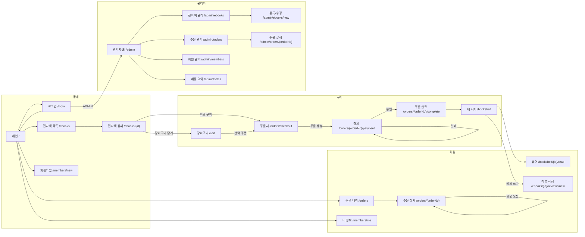

# ebook 커머스 서비스 - 화면 흐름

> 회원 화면과 API는 user 앱, `/admin/**`와 `/api/v1/admin/**`는 admin 앱(포트 9082)에서 제공합니다.

## 1. 사용자 역할과 진입점

| 역할 | 진입 | 할 수 있는 일 |
|---|---|---|
| 비회원 | `/` | 전자책 검색, 상세 조회, 리뷰 보기, 회원가입, 로그인 |
| 회원 (USER) | `/` 로그인 후 | 장바구니, 주문, 결제, 내 서재, 뷰어, 환불, 리뷰 작성, 주문 내역 |
| 관리자 (ADMIN) | `/admin` | 전자책 등록 관리(파일 업로드), 주문/결제 조회, 환불 처리, 회원 조회, 매출 요약 |

## 2. 전체 화면 흐름



## 3. 화면 목록 (Thymeleaf)

| # | 화면 | URL | 권한 | 주요 내용 |
|---|---|---|---|---|
| 1 | 메인 | GET `/` | 전체 | 검색창, 베스트셀러(sales_count), 신간, 카테고리 |
| 2 | 전자책 목록 | GET `/ebooks?keyword=&categoryId=&sort=&page=` | 전체 | 검색, 분류, 정렬(인기/신간/가격), 페이징, 할인율 표시 |
| 3 | 전자책 상세 | GET `/ebooks/{ebookId}` | 전체 | 표지, 가격, 소개, 평균 별점, 리뷰 목록, [장바구니] [바로 구매] (보유 시 [서재에서 읽기]) |
| 4 | 로그인 | GET/POST `/login` | 전체 | Form Login |
| 5 | 회원가입 | GET/POST `/members/new` | 전체 | 가입 시 CART 자동 생성 |
| 6 | 장바구니 | GET `/cart` | USER | 담긴 항목, 합계, 항목 삭제, 선택 주문 |
| 7 | 주문서 | GET `/orders/checkout?itemIds=` 또는 `?ebookId=` | USER | 주문 항목 확인, 결제 수단 선택, 합계. POST로 주문 생성(PENDING) |
| 8 | 결제 | GET `/orders/{orderNo}/payment` | USER | Mock PG 화면: [결제 승인] [결제 실패 시뮬레이션] [취소] |
| 9 | 주문 완료 | GET `/orders/{orderNo}/complete` | USER | 주문번호, 결제 금액, [내 서재로] |
| 10 | 주문 내역 | GET `/orders` | USER | 주문 목록, 상태, 페이징 |
| 11 | 주문 상세 | GET `/orders/{orderNo}` | USER | 항목별 상태, 결제 정보, 항목별 [환불 요청] (조건 충족 시) |
| 12 | 내 서재 | GET `/bookshelf` | USER | 보유 전자책, 최근 읽은 순, 진행률, [읽기] [리뷰 쓰기] |
| 13 | 뷰어 | GET `/bookshelf/{bookshelfId}/read?page=` | USER (본인) | 간단한 페이지 뷰어(텍스트/PDF.js), 페이지 이동 시 last_read_page 갱신(API) |
| 14 | 리뷰 작성/수정 | GET/POST `/ebooks/{id}/reviews/new`, `/reviews/{id}/edit` | USER (구매자) | 별점, 내용 |
| 15 | 내 정보 | GET `/members/me` | USER | 기본 정보, 보유 쿠폰(v2), 비밀번호 변경 |
| 16 | 관리자 홈 | GET `/admin` | ADMIN | 오늘 주문 수, 매출, 환불 대기 |
| 17 | 전자책 관리 | GET `/admin/ebooks` | ADMIN | 목록, 상태 변경(판매/중지/숨김) |
| 18 | 전자책 등록/수정 | GET/POST `/admin/ebooks/new`, `/admin/ebooks/{id}/edit` | ADMIN | 서지, 가격, 표지 URL, 파일 업로드(multipart) |
| 19 | 주문 관리 | GET `/admin/orders?status=&from=&to=` | ADMIN | 전체 주문 조회 |
| 20 | 주문 상세(관리자) | GET `/admin/orders/{orderNo}` | ADMIN | 결제 정보, 강제 환불 |
| 21 | 회원 관리 | GET `/admin/members` | ADMIN | 조회, 탈퇴 처리 |
| 22 | 매출 요약 | GET `/admin/sales?month=` | ADMIN | 월별 매출, 카테고리별, 상위 전자책 (집계 쿼리) |
| 23 | AI 도서 추천 | GET `/chat`, POST `/chat/messages`, POST `/chat/stream`, POST `/chat/new` | USER | 대화 이력, 질문 입력(500자), 오늘 남은 사용량, 답변마다 추천 전자책 카드. `/chat/stream`은 답변을 글자 단위로 보내고(SSE), 스크립트가 없으면 `/chat/messages` 폼 전송으로 동작 |
| 24 | 챗봇 프롬프트 | GET `/admin/chat-prompts`, GET/POST `/admin/chat-prompts/{id}` | ADMIN | 시스템 프롬프트 수정, 변경 이력, 사용/중단 |
| 25 | 챗봇 계정 설정 | GET `/admin/chat-members`, POST `/admin/chat-members/{memberId}` | ADMIN | 계정별 사용 여부와 일일 토큰 한도, 오늘 사용량 |
| 26 | 챗봇 사용량 | GET `/admin/chat-usage?date=`, POST `/admin/chat-usage/settings` | ADMIN | 날짜별 토큰과 추정 비용, 전체 중단 스위치, 기본·전체 한도 |
| - | 에러 | `/error/403`, `/error/404`, `/error/500` | 전체 | |

### 전자책 상세 화면의 버튼 분기

```
로그인 안 함             → [장바구니] [바로 구매] 클릭 시 로그인으로
서재에 보유 (is_active=1) → [서재에서 읽기]  (구매 버튼 숨김)
장바구니에 이미 있음      → [장바구니 보기]
STOP_SALE / HIDDEN       → "판매 중지된 도서입니다" (보유자는 읽기 가능)
```

## 4. 주문과 결제 흐름 (핵심 시나리오)

```
[주문서]  POST /orders
  OrderService.create(memberId, ebookIds, method)
    1. 전자책 ON_SALE 확인, 서재 보유 여부 확인 (보유 시 ALREADY_OWNED)
    2. ORDERS(PENDING) + ORDER_ITEM(price_snapshot) 생성, order_no 발번
    3. PAYMENT(READY, amount = paid_amount) 생성
    4. 장바구니에서 온 항목이면 CART_ITEM 삭제
  → redirect /orders/{orderNo}/payment

[결제]  POST /orders/{orderNo}/payment/approve
  PaymentService.approve(orderNo, memberId)
    (트랜잭션 밖) PaymentGateway.approve(orderNo, amount) → MockPG: 승인 또는 실패 응답
    (트랜잭션)
    1. ORDERS를 PESSIMISTIC_WRITE로 조회, 상태 PENDING인지 확인 (중복 결제 방지)
    2. 승인 금액 == paid_amount 확인
    3. 승인: PAYMENT APPROVED(pg_tid), ORDERS PAID, 항목마다 BOOKSHELF 생성(또는 is_active=1 복구), EBOOK.sales_count +1
       실패: PAYMENT FAILED(fail_reason), ORDERS PENDING 유지
  → 승인: /orders/{orderNo}/complete   실패: 결제 화면으로 돌아가 사유 표시

[환불]  POST /orders/{orderNo}/items/{orderItemId}/refund
  OrderService.refund(orderNo, orderItemId, memberId)
    1. 본인 주문, 결제 후 7일 이내, BOOKSHELF.last_read_at IS NULL 확인
    2. (트랜잭션 밖) PaymentGateway.cancel(pg_tid, price_snapshot)  부분 취소
    3. ORDER_ITEM REFUNDED, BOOKSHELF is_active=0, sales_count -1
       모든 항목이 REFUNDED면 ORDERS REFUNDED, PAYMENT CANCELED

[스케줄러] 10분마다: ordered_at < now - 30분 인 PENDING 주문 → CANCELED
```

## 5. REST API (JWT)

| 메서드 | URL | 권한 | 설명 |
|---|---|---|---|
| POST | `/api/v1/auth/login`, `/api/v1/auth/refresh` | 전체 | 토큰 |
| POST | `/api/v1/members` | 전체 | 회원가입 |
| GET | `/api/v1/members/me` | USER | 내 정보 |
| GET | `/api/v1/ebooks`, `/api/v1/ebooks/{id}` | 전체 | 목록(검색, 정렬, 페이징), 상세 |
| GET | `/api/v1/ebooks/{id}/reviews` | 전체 | 리뷰 목록 |
| GET/POST/DELETE | `/api/v1/cart`, `/api/v1/cart/items`, `/api/v1/cart/items/{id}` | USER | 장바구니 |
| POST | `/api/v1/orders` | USER | 주문 생성 `{ ebookIds[], method }` |
| GET | `/api/v1/orders`, `/api/v1/orders/{orderNo}` | USER | 주문 내역, 상세 |
| POST | `/api/v1/orders/{orderNo}/payment/approve` | USER | 결제 승인 |
| POST | `/api/v1/orders/{orderNo}/cancel` | USER | PENDING 주문 취소 |
| POST | `/api/v1/orders/{orderNo}/items/{itemId}/refund` | USER | 항목 환불 |
| GET | `/api/v1/bookshelf` | USER | 내 서재 |
| GET | `/api/v1/bookshelf/{id}/content?page=` | USER | 페이지 내용 (뷰어용) |
| PATCH | `/api/v1/bookshelf/{id}/progress` | USER | `{ page }` 읽은 위치 저장 |
| POST/PUT/DELETE | `/api/v1/ebooks/{id}/reviews`, `/api/v1/reviews/{id}` | USER | 리뷰 |
| POST/PUT/PATCH | `/api/v1/admin/ebooks`, `/api/v1/admin/ebooks/{id}`, `/api/v1/admin/ebooks/{id}/status` | ADMIN | 전자책 관리 |
| POST | `/api/v1/admin/ebooks/{id}/file` | ADMIN | 파일 업로드 (multipart) |
| GET | `/api/v1/chat` | USER | 남은 사용량과 지난 대화 |
| POST | `/api/v1/chat/messages` | USER | 질문 → 답변과 추천 전자책 (201) |
| POST | `/api/v1/chat/new` | USER | 지금 대화를 닫고 새 대화 시작 |
| GET | `/api/v1/admin/orders`, `/api/v1/admin/orders/{orderNo}` | ADMIN | 주문 조회 |
| POST | `/api/v1/admin/orders/{orderNo}/refund` | ADMIN | 전체 환불 |
| GET | `/api/v1/admin/sales/monthly?month=` | ADMIN | 매출 집계 |

### 에러 코드 (ErrorCode enum)

| 코드 | HTTP | 상황 |
|---|---|---|
| EBOOK_NOT_FOUND / ORDER_NOT_FOUND | 404 | |
| EBOOK_NOT_ON_SALE | 400 | 판매 중지 상품 주문 |
| ALREADY_OWNED | 409 | 서재에 있는 책 재구매 |
| ALREADY_IN_CART | 409 | |
| ORDER_NOT_PENDING | 409 | 이미 결제됐거나 취소된 주문에 결제 시도 |
| PAYMENT_AMOUNT_MISMATCH | 400 | |
| PAYMENT_FAILED | 402 | PG 실패 |
| REFUND_NOT_ALLOWED | 400 | 7일 경과 또는 열람 기록 있음 |
| REVIEW_NOT_ALLOWED | 403 | 미구매자 |
| NOT_ORDER_OWNER | 403 | 타인 주문 접근 |
| CHATBOT_SUSPENDED | 503 | 챗봇을 전체 중단했거나 서비스 전체 일일 한도를 넘음 |
| CHATBOT_DISABLED | 403 | 그 계정은 챗봇을 쓸 수 없음 |
| CHAT_DAILY_LIMIT_EXCEEDED | 429 | 계정의 오늘 토큰 한도를 모두 씀 |
| CHAT_TOO_MANY_REQUESTS | 429 | 질문 사이 최소 간격을 지키지 않음 |
| CHAT_ANSWER_FAILED | 503 | 모델 호출 실패 또는 빈 응답 |
| CHAT_ANSWER_REJECTED | 400 | 모델이 답변을 거절함(stop_reason=refusal) |
