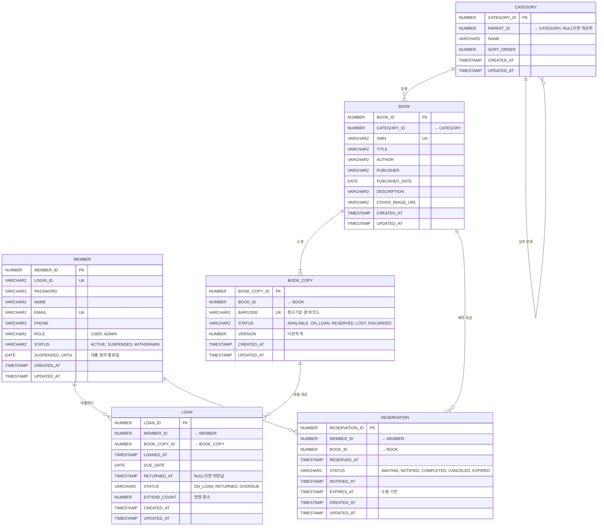

# 도서 대출 관리 서비스 - 테이블 설계

## 1. 도메인 요약

| 용어 | 설명 |
|---|---|
| 회원 (MEMBER) | 도서관 이용자. 일반 회원과 관리자(사서) |
| 도서 (BOOK) | 서지 정보. "어떤 책인가" (ISBN 단위) |
| 소장 자료 (BOOK_COPY) | 실제 책 한 권. 같은 도서가 3권 있으면 BOOK 1건, BOOK_COPY 3건 |
| 대출 (LOAN) | 회원이 소장 자료 한 권을 빌린 기록 |
| 예약 (RESERVATION) | 모든 소장 자료가 대출 중일 때 순번을 거는 것 |

"도서"와 "소장 자료"를 분리하는 이유: 대출은 항상 특정한 한 권에 대해 일어나고, 분실이나 파손도 권 단위로 관리되기 때문입니다.
도서 단위로 `AVAILABLE_COUNT`만 두면 단순하지만, 어떤 권이 누구에게 나갔는지 추적할 수 없습니다.

## 2. ERD

모든 관계선은 **FK 제약이 없는 논리 참조**입니다. 참조 무결성은 애플리케이션에서 검증합니다(`docs/01-rules.md` 1-2절).
컬럼 설명의 "→ 테이블"은 그 컬럼이 가리키는 대상입니다.



## 3. 애그리거트와 JPA 참조 방식

`docs/01-rules.md` 3-1절에 따라 같은 애그리거트 안은 객체 참조, 다른 애그리거트는 ID 값으로 참조합니다.

| 애그리거트 | 테이블 | 참조 | JPA 매핑 |
|---|---|---|---|
| Member | MEMBER | | |
| Category | CATEGORY | PARENT_ID → CATEGORY | `@ManyToOne Category parent` (NO_CONSTRAINT) |
| Book | BOOK, BOOK_COPY | BOOK.CATEGORY_ID → CATEGORY | `Long categoryId` |
| | | BOOK_COPY.BOOK_ID → BOOK | `@ManyToOne Book book` (NO_CONSTRAINT, 단방향, cascade 없음) |
| Loan | LOAN | MEMBER_ID, BOOK_COPY_ID | `Long memberId`, `Long bookCopyId` |
| Reservation | RESERVATION | MEMBER_ID, BOOK_ID | `Long memberId`, `Long bookId` |

- BOOK_COPY는 BOOK 없이 존재할 수 없어 같은 애그리거트로 묶지만, 권마다 상태와 `@Version`을 따로 가지므로 `BookCopyRepository`로 직접 저장하고 cascade는 쓰지 않습니다.
- 다른 애그리거트 데이터가 필요한 목록(예: 내 대출 목록의 도서 제목)은 JPQL 조인(`join BookCopy c on c.id = l.bookCopyId`)과 DTO Projection으로 한 번에 조회합니다.

## 4. 테이블 상세

### MEMBER
| 컬럼 | 타입 | 제약 | 설명 |
|---|---|---|---|
| MEMBER_ID | NUMBER(19) | PK | MEMBER_SEQ |
| LOGIN_ID | VARCHAR2(30 CHAR) | UK, NOT NULL | 로그인 아이디 |
| PASSWORD | VARCHAR2(100 CHAR) | NOT NULL | BCrypt 해시 |
| NAME | VARCHAR2(50 CHAR) | NOT NULL | |
| EMAIL | VARCHAR2(100 CHAR) | UK, NOT NULL | |
| PHONE | VARCHAR2(20 CHAR) | | |
| ROLE | VARCHAR2(20) | NOT NULL, CHECK | USER, ADMIN |
| STATUS | VARCHAR2(20) | NOT NULL, CHECK | ACTIVE, SUSPENDED, WITHDRAWN |
| SUSPENDED_UNTIL | DATE | | 연체로 인한 대출 정지 종료일. 지나면 ACTIVE로 복귀 |
| CREATED_AT / UPDATED_AT | TIMESTAMP | NOT NULL | |

### CATEGORY
자기참조로 2단계 분류(예: 문학 > 한국소설)를 표현합니다. 깊이는 2단계까지만 허용(서비스에서 검증).
PARENT_ID는 자기 테이블을 가리키므로 `{참조 테이블}_ID` 대신 `PARENT_ID`로 이름 붙입니다.
분류를 삭제할 때는 하위 분류와 소속 도서가 없는지 서비스에서 먼저 확인합니다(FK가 없으므로 DB가 막아 주지 않음).

### BOOK
| 컬럼 | 타입 | 제약 | 설명 |
|---|---|---|---|
| BOOK_ID | NUMBER(19) | PK | BOOK_SEQ |
| CATEGORY_ID | NUMBER(19) | 인덱스 | → CATEGORY |
| ISBN | VARCHAR2(13 CHAR) | UK | ISBN-13, 하이픈 제거 저장 |
| TITLE | VARCHAR2(200 CHAR) | NOT NULL | |
| AUTHOR | VARCHAR2(100 CHAR) | NOT NULL | |
| PUBLISHER | VARCHAR2(100 CHAR) | | |
| PUBLISHED_DATE | DATE | | |
| DESCRIPTION | VARCHAR2(2000 CHAR) | | 소개 |
| COVER_IMAGE_URL | VARCHAR2(500 CHAR) | | |

### BOOK_COPY
| 컬럼 | 타입 | 제약 | 설명 |
|---|---|---|---|
| BOOK_COPY_ID | NUMBER(19) | PK | BOOK_COPY_SEQ |
| BOOK_ID | NUMBER(19) | NOT NULL, 인덱스 | → BOOK |
| BARCODE | VARCHAR2(30 CHAR) | UK, NOT NULL | 예: LIB-000123 |
| STATUS | VARCHAR2(20) | NOT NULL, CHECK | AVAILABLE, ON_LOAN, RESERVED, LOST, DISCARDED |
| VERSION | NUMBER(10) | NOT NULL DEFAULT 0 | `@Version` 낙관적 락. 두 회원이 같은 권을 동시에 대출하는 상황 방지 |

- RESERVED: 예약자에게 "수령 가능" 알림이 간 상태. 예약자 외에는 대출 불가.

### LOAN
| 컬럼 | 타입 | 제약 | 설명 |
|---|---|---|---|
| LOAN_ID | NUMBER(19) | PK | LOAN_SEQ |
| MEMBER_ID | NUMBER(19) | NOT NULL, 인덱스 | → MEMBER |
| BOOK_COPY_ID | NUMBER(19) | NOT NULL, 인덱스 | → BOOK_COPY |
| LOANED_AT | TIMESTAMP | NOT NULL | |
| DUE_DATE | DATE | NOT NULL | 대출일 + 14일 |
| RETURNED_AT | TIMESTAMP | | NULL이면 미반납 |
| STATUS | VARCHAR2(20) | NOT NULL, CHECK | ON_LOAN, RETURNED, OVERDUE |
| EXTEND_COUNT | NUMBER(2) | NOT NULL DEFAULT 0 | |

- 인덱스: (MEMBER_ID, STATUS) 내 대출 목록 조회, (BOOK_COPY_ID) 반납 처리, (STATUS, DUE_DATE) 연체 배치.

### RESERVATION
| 컬럼 | 타입 | 제약 | 설명 |
|---|---|---|---|
| RESERVATION_ID | NUMBER(19) | PK | RESERVATION_SEQ |
| MEMBER_ID | NUMBER(19) | NOT NULL, 인덱스 | → MEMBER |
| BOOK_ID | NUMBER(19) | NOT NULL, 인덱스 | → BOOK. 예약은 "도서" 단위 (어떤 권이든 먼저 반납되는 것) |
| RESERVED_AT | TIMESTAMP | NOT NULL | 순번 기준 |
| STATUS | VARCHAR2(20) | NOT NULL, CHECK | WAITING, NOTIFIED, COMPLETED, CANCELED, EXPIRED |
| NOTIFIED_AT | TIMESTAMP | | 반납되어 수령 가능 알림 시각 |
| EXPIRES_AT | TIMESTAMP | | 알림 + 3일. 지나면 EXPIRED |

- 인덱스: (BOOK_ID, STATUS, RESERVED_AT) 대기 순번 조회, (MEMBER_ID, STATUS) 내 예약 목록.
- 유니크: 한 회원이 같은 도서를 WAITING 또는 NOTIFIED 상태로 중복 예약 불가 (서비스 검증 + 함수 기반 유니크 인덱스).

## 5. 비즈니스 규칙 (정책)

정책 값은 `application.yml`의 `library.policy.*`로 두고 `@ConfigurationProperties`로 읽습니다.

| 규칙 | 값 | 어디서 검증 |
|---|---|---|
| 1인 최대 대출 권수 | 5권 | LoanService.loan() |
| 대출 기간 | 14일 | |
| 연장 | 1회, 7일. 해당 도서에 WAITING 예약이 있으면 불가 | LoanService.extend() |
| 연체 | 반납 시 연체일수만큼 대출 정지 (SUSPENDED_UNTIL) | LoanService.return() |
| 대출 불가 조건 | 정지 중, 연체 대출 보유, 최대 권수 초과, 탈퇴 회원 | LoanService.loan() |
| 예약 가능 조건 | 모든 소장 자료가 ON_LOAN 또는 RESERVED, 본인이 대출 중이 아닐 것 | ReservationService.reserve() |
| 예약 처리 | 반납 시 가장 오래된 WAITING 예약을 NOTIFIED로, 해당 권은 RESERVED로 | LoanService.return() |
| 예약 만료 | NOTIFIED 후 3일 내 미수령 시 EXPIRED, 다음 대기자에게 넘김 | 스케줄러 |
| 연체 전환 | 매일 00:10 DUE_DATE 지난 ON_LOAN을 OVERDUE로 | 스케줄러 (@Scheduled) |

## 6. 상태 전이

```
BOOK_COPY : AVAILABLE ──대출──▶ ON_LOAN ──반납(예약 없음)──▶ AVAILABLE
                                      └─반납(예약 있음)──▶ RESERVED ──예약자 대출──▶ ON_LOAN
                                                                     └─예약 만료──▶ AVAILABLE 또는 다음 예약자
            AVAILABLE / ON_LOAN ──분실 신고──▶ LOST        AVAILABLE ──폐기──▶ DISCARDED

LOAN      : ON_LOAN ──반납──▶ RETURNED
            ON_LOAN ──기한 경과──▶ OVERDUE ──반납──▶ RETURNED

RESERVATION : WAITING ──반납 발생──▶ NOTIFIED ──대출 완료──▶ COMPLETED
              WAITING / NOTIFIED ──회원 취소──▶ CANCELED
              NOTIFIED ──3일 경과──▶ EXPIRED
```

## 7. 트랜잭션 경계 (학습 포인트)

- `loan()` : 회원 검증 → 소장 자료 상태 확인 → BOOK_COPY.status 변경 → LOAN insert. 한 트랜잭션.
  BOOK_COPY에 `@Version`을 두어 동시 대출 시 `OptimisticLockException` → 사용자에게 "이미 대출된 자료" 안내.
- `return()` : LOAN 상태 변경 → 연체 계산 → MEMBER 정지 처리 → 예약 대기자 확인 → BOOK_COPY 상태 결정. 한 트랜잭션.
- 조회 서비스는 `@Transactional(readOnly = true)`.
- N+1 확인 포인트: 소장 자료 목록 (BOOK_COPY → BOOK `@ManyToOne`). fetch join 적용 전후 쿼리 수를 커밋으로 남깁니다.
  내 대출 목록 (LOAN → BOOK_COPY → BOOK)은 ID 참조라 지연 로딩이 일어나지 않으므로 JPQL 조인 + DTO Projection으로 조회합니다.

## 8. 확장 아이디어 (v2)

- 대출 이력 통계 (인기 도서, 카테고리별 대출 수) : 집계 쿼리와 인덱스 학습
- 이메일 알림 (예약 도서 수령 가능) : 이벤트(@TransactionalEventListener) + 비동기
- 도서 검색 고도화 : Oracle Text 또는 외부 검색 엔진
