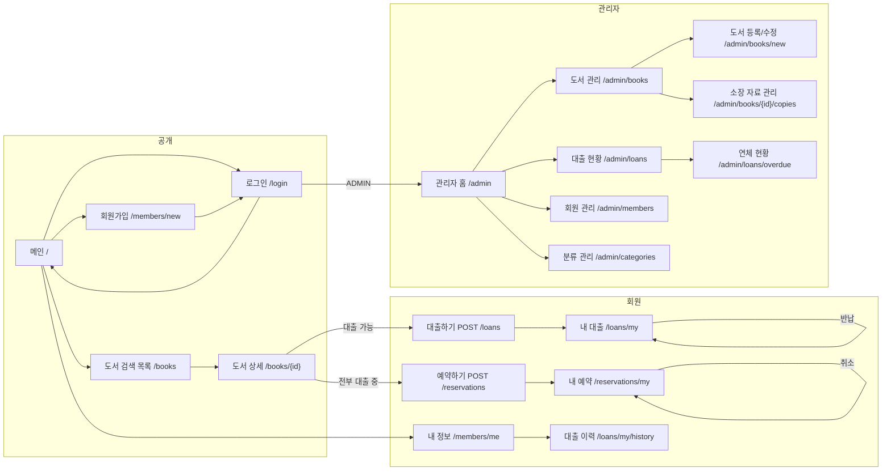

# 도서 대출 관리 서비스 - 화면 흐름

> 회원 화면과 API는 user 앱, `/admin/**`와 `/api/v1/admin/**`는 admin 앱(포트 9081)에서 제공합니다.

## 1. 사용자 역할과 진입점

| 역할 | 진입 | 할 수 있는 일 |
|---|---|---|
| 비회원 | `/` | 도서 검색, 도서 상세 조회, 회원가입, 로그인 |
| 회원 (USER) | `/` 로그인 후 | 대출, 반납 요청, 연장, 예약, 내 대출/예약 이력, 내 정보 |
| 관리자 (ADMIN) | `/admin` | 도서/소장 자료 등록 관리, 대출 반납 처리(데스크), 회원 관리, 연체 현황 |

> 실제 도서관처럼 "대출과 반납은 데스크(관리자)가 처리"하는 방식과,
> 학습용으로 "회원이 직접 대출 버튼을 누르는" 방식 중 **회원 직접 대출** 방식을 기본으로 합니다.
> 관리자 화면에서도 같은 서비스 메서드를 호출하므로 두 방식을 모두 지원할 수 있습니다.

## 2. 전체 화면 흐름



## 3. 화면 목록 (Thymeleaf)

| # | 화면 | URL | 권한 | 주요 내용 |
|---|---|---|---|---|
| 1 | 메인 | GET `/` | 전체 | 검색창, 신착 도서, 인기 도서, 내 대출 요약(로그인 시) |
| 2 | 도서 목록/검색 | GET `/books?keyword=&categoryId=&page=` | 전체 | 제목/저자 검색, 분류 필터, 페이징, 대출 가능 여부 뱃지 |
| 3 | 도서 상세 | GET `/books/{bookId}` | 전체 | 서지 정보, 소장 자료별 상태, 대출/예약 버튼 (상태에 따라 분기) |
| 4 | 로그인 | GET/POST `/login` | 전체 | Spring Security Form Login |
| 5 | 회원가입 | GET/POST `/members/new` | 전체 | 아이디 중복 확인, 유효성 검사 |
| 6 | 내 정보 | GET `/members/me` | USER | 기본 정보, 정지 상태 안내, 비밀번호 변경 |
| 7 | 내 대출 | GET `/loans/my` | USER | 현재 대출 중 목록, 반납 예정일, 연장/반납 버튼, 연체 표시 |
| 8 | 대출 이력 | GET `/loans/my/history` | USER | 반납 완료 포함 전체 이력, 페이징 |
| 9 | 내 예약 | GET `/reservations/my` | USER | 대기 순번, 수령 기한, 취소 버튼 |
| 10 | 관리자 홈 | GET `/admin` | ADMIN | 오늘 대출/반납 수, 연체 건수, 예약 대기 건수 |
| 11 | 도서 관리 | GET `/admin/books` | ADMIN | 목록, 검색, 등록/수정/삭제(소프트) |
| 12 | 도서 등록/수정 | GET/POST `/admin/books/new`, `/admin/books/{id}/edit` | ADMIN | ISBN을 입력하면 국립중앙도서관 서지 정보 제공 서비스(공공데이터포털 `getbookList_v2`)로 제목, 저자, 출판사, 소개를 채움. 발행일은 연도만 제공되어 참고로 표시하고, 표지는 제공되지 않아 직접 입력. 조회 실패 시 직접 입력. 분류 선택 |
| 13 | 소장 자료 관리 | GET `/admin/books/{id}/copies` | ADMIN | 권 추가(바코드 자동 생성), 상태 변경(분실/폐기) |
| 14 | 대출 현황 | GET `/admin/loans` | ADMIN | 전체 대출 목록, 회원/도서 검색, 데스크 반납 처리 |
| 15 | 연체 현황 | GET `/admin/loans/overdue` | ADMIN | 연체 회원과 도서, 연체 일수 |
| 16 | 회원 관리 | GET `/admin/members` | ADMIN | 목록, 정지/해제, 권한 변경 |
| 17 | 분류 관리 | GET `/admin/categories` | ADMIN | 2단계 분류 트리 편집 |
| - | 에러 | `/error/403`, `/error/404`, `/error/500` | 전체 | 공통 레이아웃 |

### 도서 상세 화면의 버튼 분기

```
로그인 안 함             → [로그인 후 대출 가능]
AVAILABLE 권 있음        → [대출하기]
전부 ON_LOAN/RESERVED    → [예약하기]  (이미 예약 중이면 "예약 n번째 대기 중")
내가 이미 대출 중         → [대출 중 - 내 대출에서 확인]
회원 정지 상태            → [대출 정지 중 (~2026-11-20)]
```

## 4. REST API (JWT)

화면 컨트롤러와 API 컨트롤러는 같은 Service를 호출합니다. API는 Swagger로 문서화하고 외부 연동/테스트 용도로 둡니다.

| 메서드 | URL | 권한 | 설명 |
|---|---|---|---|
| POST | `/api/v1/auth/login` | 전체 | 토큰 발급 |
| POST | `/api/v1/auth/refresh` | 전체 | 토큰 재발급. 쓴 Refresh Token은 폐기하고 새로 발급 |
| POST | `/api/v1/auth/logout` | 전체 | Refresh Token 폐기 |
| POST | `/api/v1/members` | 전체 | 회원가입 |
| GET | `/api/v1/members/me` | USER | 내 정보 |
| GET | `/api/v1/books` | 전체 | 검색, 페이징 |
| GET | `/api/v1/books/{id}` | 전체 | 상세 + 소장 자료 상태 |
| POST | `/api/v1/loans` | USER | 대출 `{ bookCopyId }` 또는 `{ bookId }`(가용 권 자동 선택) |
| POST | `/api/v1/loans/{id}/return` | USER | 반납 |
| POST | `/api/v1/loans/{id}/extend` | USER | 연장 |
| GET | `/api/v1/loans/my` | USER | 내 대출 |
| POST | `/api/v1/reservations` | USER | 예약 `{ bookId }` |
| DELETE | `/api/v1/reservations/{id}` | USER | 예약 취소 |
| GET | `/api/v1/reservations/my` | USER | 내 예약 |
| POST/PUT/DELETE | `/api/v1/admin/books`, `/api/v1/admin/books/{id}` | ADMIN | 도서 관리 |
| POST/PATCH | `/api/v1/admin/books/{id}/copies`, `/api/v1/admin/copies/{id}/status` | ADMIN | 소장 자료 |
| GET | `/api/v1/admin/loans`, `/api/v1/admin/loans/overdue` | ADMIN | 대출/연체 현황 |
| PATCH | `/api/v1/admin/members/{id}/status` | ADMIN | 회원 정지/해제 |

### 공통 응답

```json
{ "success": true, "data": { ... }, "error": null }
{ "success": false, "data": null, "error": { "code": "LOAN_LIMIT_EXCEEDED", "message": "최대 대출 권수(5권)를 초과했습니다." } }
```

### 에러 코드 (ErrorCode enum)

| 코드 | HTTP | 상황 |
|---|---|---|
| MEMBER_NOT_FOUND | 404 | |
| DUPLICATE_LOGIN_ID | 409 | 회원가입 |
| BOOK_NOT_FOUND / COPY_NOT_FOUND | 404 | |
| COPY_NOT_AVAILABLE | 409 | 이미 대출 중인 권 |
| LOAN_LIMIT_EXCEEDED | 400 | 5권 초과 |
| MEMBER_SUSPENDED | 403 | 정지 중 |
| HAS_OVERDUE_LOAN | 400 | 연체 보유 |
| EXTEND_NOT_ALLOWED | 400 | 연장 횟수 초과 또는 예약 대기자 존재 |
| RESERVATION_NOT_ALLOWED | 400 | 가용 권 있음, 본인 대출 중, 중복 예약 |
| OPTIMISTIC_LOCK | 409 | 동시 대출 충돌 |

## 5. 핵심 시나리오

### 대출
```
회원 → 도서 상세 → [대출하기]
  → LoanService.loan(memberId, bookId)
     1. 회원 상태 확인 (ACTIVE, 정지 아님, 연체 없음, 대출 5권 미만)
     2. 해당 도서의 AVAILABLE 권 1개 선택 (예약자 본인이면 RESERVED 권 허용)
     3. BOOK_COPY.status = ON_LOAN  (@Version 충돌 시 재시도 없이 실패 응답)
     4. LOAN insert (due_date = 오늘 + 14)
     5. 예약으로 들어온 경우 RESERVATION.status = COMPLETED
  → 내 대출 화면으로 redirect, 플래시 메시지
```

### 반납
```
회원 [반납] 또는 관리자 데스크 [반납 처리]
  → LoanService.returnBook(loanId)
     1. LOAN.status = RETURNED, returned_at = now
     2. 연체일 = max(0, 오늘 - due_date). 연체면 MEMBER.status = SUSPENDED, suspended_until = 오늘 + 연체일
     3. 해당 도서의 가장 오래된 WAITING 예약 조회
        - 있음: RESERVATION → NOTIFIED(expires_at = now + 3일), BOOK_COPY → RESERVED
        - 없음: BOOK_COPY → AVAILABLE
```

### 스케줄러 (매일 00:10)
```
1. due_date < 오늘 인 ON_LOAN → OVERDUE
2. expires_at < now 인 NOTIFIED 예약 → EXPIRED, 다음 WAITING 예약자에게 넘기거나 권을 AVAILABLE로
3. suspended_until < 오늘 인 SUSPENDED 회원 → ACTIVE
```
